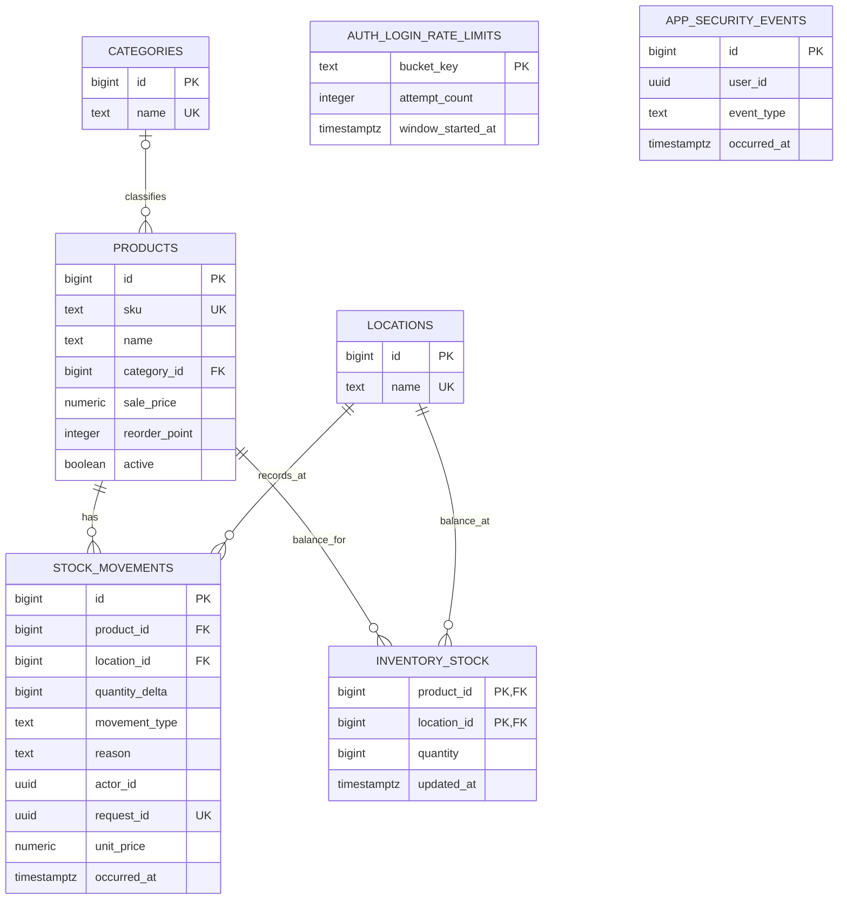
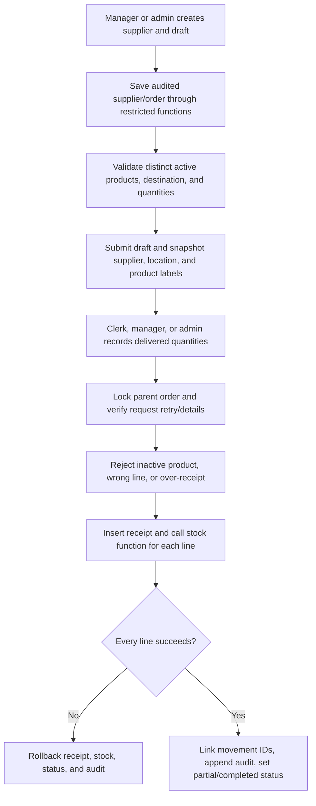
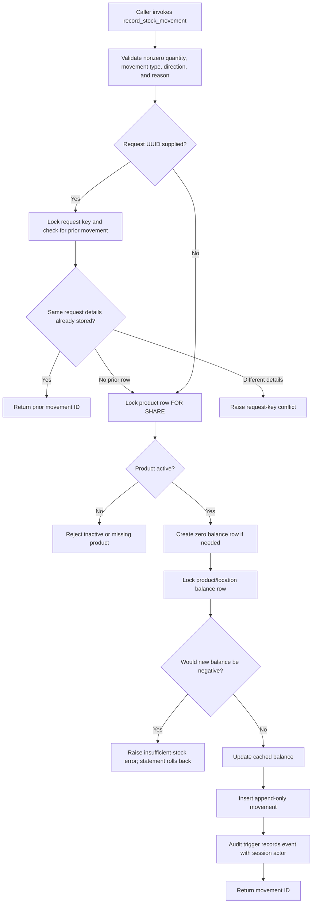

# Architecture

## Current state

The repository combines a Next.js App Router product catalog and inventory workflow with a PostgreSQL 17 database. `/stock` shows active product balances and reorder attention for a selected location and provides receiving and manual sale-deduction forms subject to role permissions. `/activity` filters signed movement rows and displays the authenticated actor for new events. Session identity and permissions are checked server-side; stock and product writes use `APP_DATABASE_URL` and pass a database-validated user UUID for audit attribution.

The stack is TypeScript, React, Next.js, Tailwind CSS, PostgreSQL, and the `pg` driver. `npm run db:migrate` applies numbered SQL files. The runner serializes migration runs with an advisory lock, stores a SHA-256 checksum for each applied version, and wraps each migration and ledger record in one transaction. An applied SQL file whose checksum changes is rejected; follow-up schema changes belong in a new numbered migration. There is no automatic rollback command.

## Data model

The schema separates catalog entities, movement history, current stock, audit events, and temporary login-throttle buckets. Products and locations each have their own identities; movements reference both. `inventory_stock` is a cached balance projection keyed by product and location. The `stock_balances` view reads this projection. New stock changes must go through `record_stock_movement`, which locks the corresponding balance row, checks that the result remains nonnegative, updates the projection, and inserts the movement within the same database statement transaction.

See [EMPLOYER_DATABASE_DESIGN.md](EMPLOYER_DATABASE_DESIGN.md) for the full field/key diagram, normalization rationale, and maintained portfolio explanation of the relationships.



`inventory_audit_log` is an additional append-only table. Triggers record product inserts, updates, and deletes, with before/after JSON for product changes, and stock-movement inserts with the movement row. Actor and request UUIDs are nullable. Migration 002 does not backfill legacy product or movement rows into the audit log; it records events from the time those triggers are installed. `stock_movements` also has an append-only trigger; corrections are represented by a compensating movement. Triggers reject row updates/deletes and `TRUNCATE` on movement and audit history during normal operations. Product changes themselves remain allowed and are recorded. The audit records are inventory history, not a complete financial ledger.

`app_security_events` is a separate append-only log for password changes and administrator resets. It stores the subject UUID, nullable actor UUID, event type, and timestamp; no password, hash, email, or direct account foreign key. Migrations 016–018 use a restricted trigger to append the event and revoke all sessions in the password-update transaction. Administrator actor attribution comes from the verified application session and is not independently authenticated by PostgreSQL. The runtime app role cannot read or write this table directly.

Migration 002 adds categories with case-insensitive trimmed-name uniqueness, optional `sale_price`, an `active` flag, typed movements (`receiving`, `sale`, `return`, `adjustment`), optional unit price, actor/request identifiers, an occurred-at timestamp, and normalized case-insensitive SKU uniqueness. Migration 003 adds the `save_product` security-definer function, available to the limited app role; it validates catalog inputs, writes product rows, and lets existing audit triggers record changes. Migration 004 seeds a `Demo Store` only if the database has no locations. Migration 005 enforces active-product status inside `record_stock_movement`: it locks the product row `FOR SHARE`, so a concurrent deactivation cannot race with a new stock movement. Existing negative movement balances cause migration 002 to fail rather than silently initializing an invalid cached balance. Legacy nonnegative movement sums initialize `inventory_stock`; legacy rows are not copied into `inventory_audit_log`.

## Stock write path

The SQL stock function and its application forms/actions are implemented. The stock action validates positive whole-unit quantities, IDs, request UUIDs, and reason text, then calls `record_stock_movement` through `APP_DATABASE_URL` with the user ID resolved from the verified server session. The function accepts an optional request UUID; a matching retry returns the original movement ID and reusing that UUID for different details raises an error. The product row is checked as active under `FOR SHARE`; then the balance row is locked, a negative result is rejected, and the balance update, movement insert, and audit trigger complete atomically. The application is configured for local development; production deployment controls have not been implemented or reviewed.

## Supplier purchasing and receipt path

Migrations 019–020 and the application pages define a normalized supplier directory and purchase-order lifecycle. Supplier contact data is stored once. A purchase order references a supplier and one delivery location; distinct order-line rows store active product references and positive whole-unit quantities. Submitted supplier/location/product labels are snapshotted for history. Receipt headers and lines store each actual delivery. Received totals are derived from receipt lines, avoiding a second writable counter. Each receipt line has a unique foreign key to the corresponding stock movement.



The entire receipt function runs in the caller's database statement transaction. Stock movements, balance projection, receipt links, audit rows, and lifecycle status therefore commit together. A transaction advisory lock serializes requests sharing a receipt UUID; exact matching retries return the previous result, while changed payloads are rejected. Parent-order row locks serialize separate receipts and cancellation/submission against the remaining amount. Migrations and UI acceptance remain subject to local Docker verification; purchasing concurrency testing is a documented gap.

The permission model gives every role read access; managers/admins create and submit orders and edit suppliers; only administrators activate/deactivate suppliers; clerks/managers/admins receive orders. Pages and server actions check the session role. Purchasing database functions also check the supplied actor UUID against the active role. PostgreSQL still trusts that UUID from the trusted app server over its shared runtime login; it is not an independently authenticated database identity. Purchasing is quantity-only with no cost, currency, invoice, payment, tax, or accounting entry.

Administrator password resets use the verified `users:manage` permission, require an active target other than the acting administrator, and accept a matching temporary password of at least 14 characters. The transaction locks actor and target accounts in a stable order, updates the target hash and `password_change_required`, and sets the verified actor UUID for the restricted audit trigger. That trigger records `admin_password_reset` and deletes the target's sessions atomically. Login locks the account while it verifies the hash and creates a session, preventing a stale-password login from racing past the reset. The user can sign in with the temporary credential but server authorization redirects protected routes/actions until a successful password change clears the flag; the self-service password change event is recorded as `password_changed`.



### Pseudocode matching the database function

```text
record_stock_movement(product, location, delta, type, reason, actor?, request?, price?):
    reject a zero delta, unsupported type, invalid direction, or blank reason

    if request UUID is present:
        lock that request UUID
        if it already exists with identical movement details:
            return its movement ID
        if it exists with different details:
            reject the request

    lock the product row FOR SHARE
    if the product is missing or inactive:
        reject the movement

    create the product/location balance row with zero if absent
    lock that balance row
    if current balance + delta is negative:
        reject; the database statement rolls back

    update cached balance by delta
    insert the movement record
    let the audit trigger append an audit event with the verified session actor
    return the new movement ID
```

## Database role boundary and limits

Migration 002 creates `inventory_app` as `NOLOGIN` and grants it limited catalog/history reads and stock-function execution. Migrations 003 and 009 grant the controlled product-write function, not direct catalog table writes. Migrations 008–010 add app users, opaque hashed sessions, and actor foreign keys. Migration 011 adds throttled-login functions over HMAC digests; the application role cannot query the backing table. Migration 014 revokes every session after role changes or account deactivation, using a restricted trigger owner with column-level session access. Migration 015 indexes activity history for newest-first display and actor/date filters. Migrations 016–018 add database-triggered password-change/reset events, session revocation, and forced password replacement. Four app roles are enforced by server-side page/action checks; an Administrator can create, activate, deactivate, and reset users. The `inventory_runtime` login is separate from project AI agents and receives no identities from them.

The security-definer functions run with `inventory_function_owner` privileges and fix their `search_path` to `pg_catalog, public, pg_temp`, with the temporary schema last. Database-backed sessions authenticate app users and server-side permission checks gate pages and actions. The Administrator can create/deactivate accounts and reset passwords for other active users; PostgreSQL revokes every session when a role changes, an account is deactivated, or its password changes. A forced-change flag blocks protected pages and actions until the user changes the temporary password. Clerks can receive stock, add sellable customer returns, and record sale deductions. Only Managers and Administrators can create count adjustments, which require a direction and reason and cannot make stock negative. Login attempts use database-backed expiring HMAC-keyed buckets. Global response headers add MIME-sniffing, framing, referrer, and browser-permission protections, hide the framework banner, and are asserted by the auth smoke check. This is a local portfolio implementation, not a claim of production-grade security: database owners/superusers can change functions, triggers, or data. Email-based password recovery, account lockout, CSP/HSTS deployment decisions, and production secrets/TLS/network policy remain future work.

## Inventory audit trail and accounting boundary

GitHub Actions passed the CI-only competing-deduction check against a disposable database for `v1.0.0` on [main](https://github.com/sysinfo7/Inventory_System/actions/runs/38491097632) and [the release tag](https://github.com/sysinfo7/Inventory_System/actions/runs/38491097851). It verifies that two simultaneous four-unit sales cannot reduce a five-unit balance below zero. The movement and audit tables can support an inventory history of quantity changes. They do not implement double-entry bookkeeping, inventory valuation policy, period closing, reconciliation, tax calculations, payment handling, or regulatory compliance. Do not present this project as a financial accounting or compliance system.

## Screenshot evidence

The user manual embeds screenshots captured from the running local app, including overview, catalog, product validation, stock operations, activity history, permissions, and the purchase-order register and lifecycle. See [the user manual](USER_MANUAL.md) for the images and coverage notes. All displayed business records are fictional; captures must not expose credentials or user email addresses.
