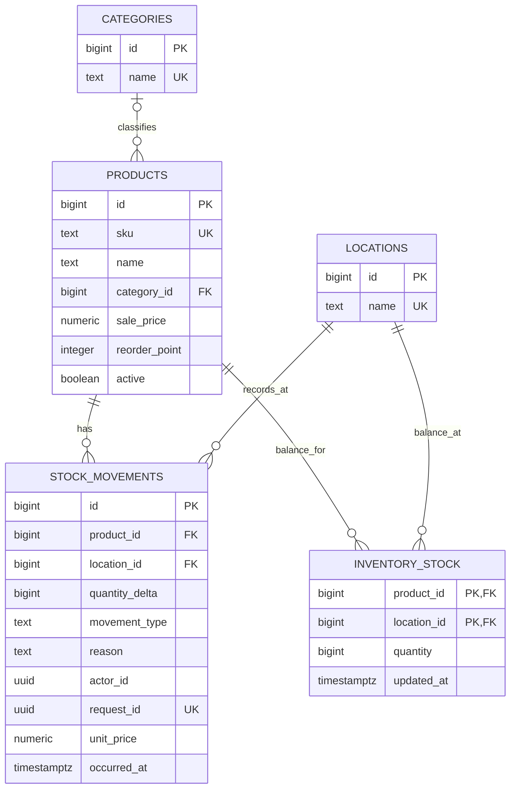
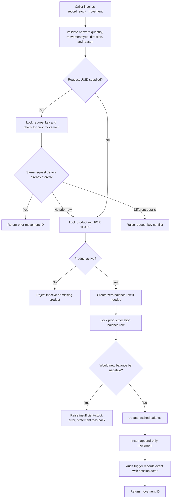

# Architecture

## Current state

The repository combines a Next.js App Router product catalog and inventory workflow with a PostgreSQL 17 database. `/stock` shows active product balances and reorder attention for a selected location and provides receiving and manual sale-deduction forms subject to role permissions. `/activity` filters signed movement rows and displays the authenticated actor for new events. Session identity and permissions are checked server-side; stock and product writes use `APP_DATABASE_URL` and pass a database-validated user UUID for audit attribution.

The stack is TypeScript, React, Next.js, Tailwind CSS, PostgreSQL, and the `pg` driver. `npm run db:migrate` applies numbered SQL files. The runner serializes migration runs with an advisory lock, stores a SHA-256 checksum for each applied version, and wraps each migration and ledger record in one transaction. An applied SQL file whose checksum changes is rejected; follow-up schema changes belong in a new numbered migration. There is no automatic rollback command.

## Data model

The schema separates catalog entities, movement history, current stock, and audit events. Products and locations each have their own identities; movements reference both. `inventory_stock` is a cached balance projection keyed by product and location. The `stock_balances` view reads this projection. New stock changes must go through `record_stock_movement`, which locks the corresponding balance row, checks that the result remains nonnegative, updates the projection, and inserts the movement within the same database statement transaction.

See [EMPLOYER_DATABASE_DESIGN.md](EMPLOYER_DATABASE_DESIGN.md) for the full field/key diagram, normalization rationale, and maintained portfolio explanation of the relationships.



`inventory_audit_log` is an additional append-only table. Triggers record product inserts, updates, and deletes, with before/after JSON for product changes, and stock-movement inserts with the movement row. Actor and request UUIDs are nullable. Migration 002 does not backfill legacy product or movement rows into the audit log; it records events from the time those triggers are installed. `stock_movements` also has an append-only trigger; corrections are represented by a compensating movement. Triggers reject row updates/deletes and `TRUNCATE` on movement and audit history during normal operations. Product changes themselves remain allowed and are recorded. The audit records are inventory history, not a complete financial ledger.

Migration 002 adds categories with case-insensitive trimmed-name uniqueness, optional `sale_price`, an `active` flag, typed movements (`receiving`, `sale`, `return`, `adjustment`), optional unit price, actor/request identifiers, an occurred-at timestamp, and normalized case-insensitive SKU uniqueness. Migration 003 adds the `save_product` security-definer function, available to the limited app role; it validates catalog inputs, writes product rows, and lets existing audit triggers record changes. Migration 004 seeds a `Demo Store` only if the database has no locations. Migration 005 enforces active-product status inside `record_stock_movement`: it locks the product row `FOR SHARE`, so a concurrent deactivation cannot race with a new stock movement. Existing negative movement balances cause migration 002 to fail rather than silently initializing an invalid cached balance. Legacy nonnegative movement sums initialize `inventory_stock`; legacy rows are not copied into `inventory_audit_log`.

## Stock write path

The SQL stock function and its application forms/actions are implemented. The stock action validates positive whole-unit quantities, IDs, request UUIDs, and reason text, then calls `record_stock_movement` through `APP_DATABASE_URL` with `actor_id = NULL`. The function accepts an optional request UUID; a matching retry returns the original movement ID and reusing that UUID for different details raises an error. The product row is checked as active under `FOR SHARE`; then the balance row is locked, a negative result is rejected, and the balance update, movement insert, and audit trigger complete atomically. The `/stock` and `/activity` route/action paths return an unavailable state outside `NODE_ENV=development`. The catalog actions have the same local-development boundary.



### Pseudocode matching the database function

```text
record_stock_movement(product, location, delta, type, reason, actor?, request?, price?):
    reject a zero delta, unsupported type, invalid direction, or blank reason

    if request UUID is present:
        lock that request UUID
        if it already exists with identical movement details:
            return its movement ID
        if it exists with different details:
            reject the request

    lock the product row FOR SHARE
    if the product is missing or inactive:
        reject the movement

    create the product/location balance row with zero if absent
    lock that balance row
    if current balance + delta is negative:
        reject; the database statement rolls back

    update cached balance by delta
    insert the movement record
    let the audit trigger append an audit event with the verified session actor
    return the new movement ID
```

## Database role boundary and limits

Migration 002 creates `inventory_app` as `NOLOGIN` and grants it limited catalog/history reads and stock-function execution. Migrations 003 and 009 grant the controlled product-write function, not direct catalog table writes. Migrations 008–010 add app users, opaque hashed sessions, and actor foreign keys. Four app roles are enforced by server-side page/action checks; an Administrator can create, activate, and deactivate users. The `inventory_runtime` login is separate from project AI agents and receives no identities from them. The local database has migrations through 010 applied and the connection check passed.

The security-definer functions run with `inventory_function_owner` privileges and fix their `search_path` to `pg_catalog, public, pg_temp`, with the temporary schema last. Database-backed sessions authenticate app users and server-side permission checks gate pages and actions. The Administrator can create/deactivate accounts; role changes take effect on the next request because the app resolves the role from the database. This is a local portfolio implementation, not a claim of production-grade security: database owners/superusers can change functions, triggers, or data. Rate limits, password recovery, and production secrets/TLS/network policy remain future work.

## Inventory audit trail and accounting boundary

The movement and audit tables can support an inventory history of quantity changes. They do not implement double-entry bookkeeping, inventory valuation policy, period closing, reconciliation, tax calculations, payment handling, or regulatory compliance. Do not present this project as a financial accounting or compliance system.

## Screenshot evidence

Screenshots are pending. The local app is now reachable with fictional sample data. Capture these views from the running app:

1. `docs/screenshots/home-desktop.png` — current project-status landing page at desktop width.
2. `docs/screenshots/home-mobile.png` — current landing page at a narrow mobile viewport.
3. `docs/screenshots/catalog.png` — active catalog list with fictional products.
4. `docs/screenshots/product-form.png` — add/edit form and clear validation state.
5. `docs/screenshots/stock-on-hand.png` — selected location, active product balances, and reorder attention.
6. `docs/screenshots/stock-movement.png` — receiving and manual sale-deduction forms, including a real success result.
7. `docs/screenshots/activity.png` — filters and signed movement rows with fictional data.

Use fictional data. Do not use mockups as screenshots or expose credentials in a capture.
