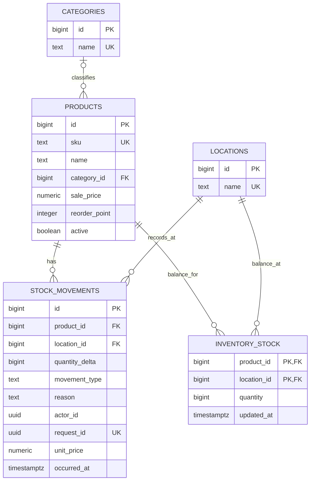
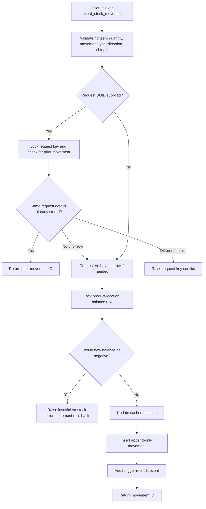

# Architecture

## Current state

The repository combines a Next.js App Router project page with a PostgreSQL 17 development database. The page is a project-status landing page; catalog, stock-entry, and insight screens remain planned. Migration 002 defines schema support for those workflows, including a controlled stock-write function, but remains unapplied to the owner's local database. The UI and application server do not call it yet.

The stack is TypeScript, React, Next.js, Tailwind CSS, PostgreSQL, and the `pg` driver. `npm run db:migrate` applies numbered SQL files. The runner serializes migration runs with an advisory lock, stores a SHA-256 checksum for each applied version, and wraps each migration and ledger record in one transaction. An applied SQL file whose checksum changes is rejected; follow-up schema changes belong in a new numbered migration. There is no automatic rollback command.

## Data model

The schema separates catalog entities, movement history, current stock, and audit events. Products and locations each have their own identities; movements reference both. `inventory_stock` is a cached balance projection keyed by product and location. The `stock_balances` view reads this projection. New stock changes must go through `record_stock_movement`, which locks the corresponding balance row, checks that the result remains nonnegative, updates the projection, and inserts the movement within the same database statement transaction.



`inventory_audit_log` is an additional append-only table. Triggers record product inserts, updates, and deletes, with before/after JSON for product changes, and stock-movement inserts with the movement row. Actor and request UUIDs are nullable. Migration 002 does not backfill legacy product or movement rows into the audit log; it records events from the time those triggers are installed. `stock_movements` also has an append-only trigger; corrections are represented by a compensating movement. Triggers reject row updates/deletes and `TRUNCATE` on movement and audit history during normal operations. Product changes themselves remain allowed and are recorded. The audit records are inventory history, not a complete financial ledger.

The migration adds categories with case-insensitive trimmed-name uniqueness, optional `sale_price`, an `active` flag, typed movements (`receiving`, `sale`, `return`, `adjustment`), optional unit price, actor/request identifiers, an occurred-at timestamp, and normalized case-insensitive SKU uniqueness. Existing negative movement balances cause migration 002 to fail rather than silently initializing an invalid cached balance. Legacy nonnegative movement sums initialize `inventory_stock`; legacy rows are not copied into `inventory_audit_log`.

## Stock write path

The SQL function is implemented, although the current application has no form, server action, or API that calls it. The caller supplies the actor UUID and optional request UUID; no authentication currently verifies the actor's identity. A repeated request UUID with matching movement details returns the existing movement ID. Reusing that UUID for different details raises an error.



### Pseudocode matching the database function

```text
record_stock_movement(product, location, delta, type, reason, actor?, request?, price?):
    reject a zero delta, unsupported type, invalid direction, or blank reason

    if request UUID is present:
        lock that request UUID
        if it already exists with identical movement details:
            return its movement ID
        if it exists with different details:
            reject the request

    create the product/location balance row with zero if absent
    lock that balance row
    if current balance + delta is negative:
        reject; the database statement rolls back

    update cached balance by delta
    insert the movement record
    let the audit trigger append the audit event
    return the new movement ID
```

## Database role boundary and limits

Migration 002 creates `inventory_app` as `NOLOGIN`, revokes public execution of `record_stock_movement`, revokes `CREATE` on the `public` schema from `PUBLIC`, and grants `inventory_app` only `SELECT` on the designated catalog/history/view/audit objects and `EXECUTE` on the stock function. It revokes `INSERT`, `UPDATE`, `DELETE`, and `TRUNCATE` on movement and cached-balance tables from `PUBLIC`. An operator must separately provision a login and appropriate membership; the migration does not configure a production login or password.

The security-definer function runs with its owner privileges and fixes its `search_path` to `pg_catalog, public`. This is a useful boundary for the intended application role, not a claim of production-grade security. Database owners/superusers can change functions, triggers, or data. There is no authentication in the application, actor attribution is caller-controlled, and the UI does not yet use the role/function path.

## Inventory audit trail and accounting boundary

The movement and audit tables can support an inventory history of quantity changes. They do not implement double-entry bookkeeping, inventory valuation policy, period closing, reconciliation, tax calculations, payment handling, or regulatory compliance. Do not present this project as a financial accounting or compliance system.

## Screenshot evidence

Screenshots are pending. The current browser inventory exposed no open browser or app, so no real application capture was available. Capture these exact views from a running app when a browser is available:

1. `docs/screenshots/home-desktop.png` — current project-status landing page at desktop width.
2. `docs/screenshots/home-mobile.png` — current landing page at a narrow mobile viewport.
3. `docs/screenshots/catalog.png` — catalog UI after it is implemented.
4. `docs/screenshots/stock-movement.png` — real receive/issue UI and its verified result after it is implemented.
5. `docs/screenshots/stock-insights.png` — location balances/low-stock UI after it is implemented.

Use fictional data. Do not use mockups as screenshots or expose credentials in a capture.
