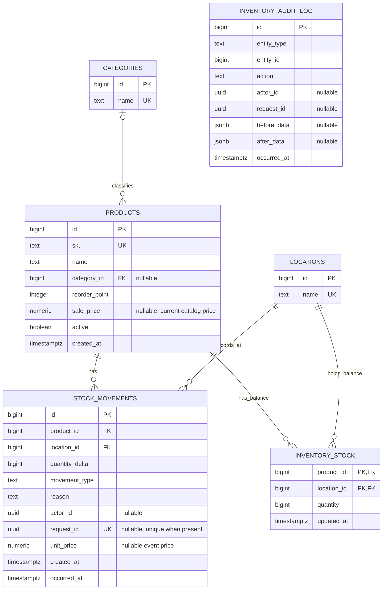
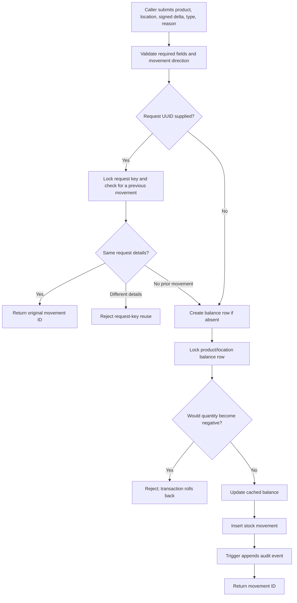

# Retail Inventory Database Design

**Portfolio overview · PostgreSQL 17 · TypeScript/Next.js application**  
**Maintained project document · Last updated 2026-10-13**

## Purpose

This document explains the relational database design for a retail inventory portfolio project. It is written for reviewers who want to understand how catalog data, stock by location, movement history, and audit events fit together. The SQL source of truth is in [`db/001_initial.sql`](../db/001_initial.sql), [`db/002_inventory_controls.sql`](../db/002_inventory_controls.sql), and [`db/003_product_catalog_writes.sql`](../db/003_product_catalog_writes.sql); operational commands are in [`DATABASE.md`](DATABASE.md).

The current web application includes a local-development product catalog for search, create, edit, and deactivate. Stock receiving and issue screens remain planned; the app does not yet authenticate users or call the database stock-write function. Migration 003 adds a controlled catalog-write function and restricted function-owner role; it must be applied and the limited runtime login provisioned before catalog changes can be saved locally.

## Entity relationship diagram

In this diagram, `PK` means primary key, `FK` means foreign key, and `UK` means a unique key or unique index. The product-to-category relationship is optional on the product side: a product can have no category or one category; a category can classify zero or more products.

`INVENTORY_AUDIT_LOG` is intentionally not drawn with a normal foreign-key connector: it stores a polymorphic `(entity_type, entity_id)` reference for product and stock-movement audit events. PostgreSQL does not enforce that pair as a foreign key. Actor IDs are also optional UUIDs without a user table or verified identity relationship in this project.

## Tables and keys

| Table | Purpose and important fields | Key and integrity rules |
| --- | --- | --- |
| `categories` | Reusable product classification with a name. | Identity primary key; trimmed, case-insensitive unique name. |
| `products` | Retail catalog record: SKU, name, optional category, reorder point, current sale price, active flag, creation time. | Identity primary key; nonblank SKU and name; SKU is case-insensitively unique after trimming; category is an optional foreign key. Price is nullable and nonnegative; reorder point is nonnegative. |
| `locations` | Store, stockroom, or other inventory location. | Identity primary key; nonblank unique name. |
| `inventory_stock` | Current cached quantity for one product at one location. | Composite primary key `(product_id, location_id)`; both columns are foreign keys; quantity cannot be negative. |
| `stock_movements` | Append-only record of a quantity change, including reason, type, optional request/actor IDs, and optional event unit price. | Identity primary key; required product and location foreign keys; nonzero signed quantity; request ID is unique when supplied. |
| `inventory_audit_log` | Before/after product records and stock-movement audit events. | Identity primary key; audit rows reject ordinary update/delete/truncate operations. Its polymorphic entity reference is not a foreign key. |
| `save_product` | Controlled database function used by the catalog create/edit form. | Security-definer function with fixed search path; validates product fields; granted to `inventory_app`, not `PUBLIC`. Product triggers append audit changes. |
| `stock_balances` | Read view exposing product, location, and quantity from `inventory_stock`. | A view, not a stored table or independent source of truth. |
| `schema_migrations` | Migration version, SHA-256 checksum, and application time. | Migration version is the primary key; the runner rejects edits to a migration already recorded as applied. |

`stock_movements.created_at` is retained from the initial schema; `occurred_at` was added for the effective event time. New movements set both when written through the database function. Existing rows receive a default `occurred_at` during migration 002.

## Normalization and the balance projection

The catalog is split into products, categories, and locations so repeated descriptive data is stored once and referenced by keys. Stock movement facts refer to product and location identities rather than repeating their names. This reduces update anomalies when a product or location name changes and provides referential integrity for movement records.

The movement table is the historical record of quantity changes. `inventory_stock` is a deliberate cached projection keyed by product and location, rather than another independently edited business fact. The `record_stock_movement` function updates this projection and appends the movement in the same transaction. The view `stock_balances` gives readers a stable balance-shaped query. Keeping the projection makes current-balance reads straightforward while preserving a movement trail for explaining how stock changed.

`products.sale_price` represents the current catalog price; `stock_movements.unit_price` can preserve a price associated with a particular movement. That distinction avoids rewriting old event details when a catalog price changes. The schema does not yet define a full valuation policy.

## Stock transaction and audit flow

The function validates a nonzero delta, supported movement type, movement direction for receiving/returns/sales, and a nonblank reason. The row lock serializes concurrent writes for the same product/location. An optional request UUID provides idempotency for matching retries and rejects reuse for different movement details. Product insert/update/delete triggers record before/after product data; a stock-movement trigger records new movement events.

## Security and audit boundaries

Migration 002 creates `inventory_app` as a `NOLOGIN` role with limited reads and stock-function execution; migration 003 adds product-function execution. Security-definer routines are owned by the separate `inventory_function_owner` `NOLOGIN` role with only the table and sequence privileges they need. Their fixed `search_path` is `pg_catalog, public, pg_temp`, with the temporary schema last. The product form calls `save_product` with parameterized values using `APP_DATABASE_URL`; `inventory_runtime` is provisioned as a separate login that inherits the group role. The route and write action are disabled outside local development. This is a useful local boundary, not a claim of production-grade security.

Audit actor IDs are nullable and caller-controlled. They do not verify a human identity. Migration 002 records events after its triggers are installed and does not backfill earlier product or movement events. Movement and audit rows reject ordinary updates/deletes, with truncate guards for those history tables; database owners and administrators can change or bypass these controls. Product changes remain allowed and generate audit events when their triggers execute.

This is an inventory history, not a complete financial accounting ledger. It does not implement double-entry bookkeeping, inventory valuation, reconciliation, close periods, payments, taxes, or compliance controls. See [`SECURITY.md`](SECURITY.md) for additional limits and deployment work.

## Migration and reproducibility

Schema changes are saved as ordered SQL files in `db/`. `npm run db:migrate` serializes migration runs with a PostgreSQL advisory lock and records each migration checksum in `schema_migrations`. A changed, already-applied migration is rejected; new schema work belongs in a new numbered file. `npm run db:check` verifies that the configured PostgreSQL connection works.

To apply or upgrade the local development database from PowerShell, run `scripts/setup-database.ps1`. This project documents clean reset, backup, and restore procedures in [`DATABASE.md`](DATABASE.md). The reset deletes the local development volume and must only be used when that data is disposable.

## Current implementation status

- Migration 001 defines the initial products, locations, movements, and aggregate balance view.
- Migration 002 defines categories, normalized SKU uniqueness, cached balances, typed movement events, audit triggers, the controlled stock function, and group-role grants.
- Migration 003 defines the controlled catalog-write function and restricted function owner. The owner reported migration 002 applied; the agent could not independently connect to the owner's database to apply/verify migration 003 or provision the runtime login.
- The web app includes a local catalog UI, but its database-backed behavior still requires migration 003 and app-role setup. Stock-entry, authentication, and reporting screens remain future work.
- No sample production or customer information is included. Use fictional data in demos.

Update this document whenever a migration changes a table, column, key, relationship, constraint, index, database function, trigger, role grant, or implementation status. Keep the diagram and relationship descriptions aligned with the SQL files, and clearly separate implemented behavior from planned application features. It is also linked from the README and database operations guide.
