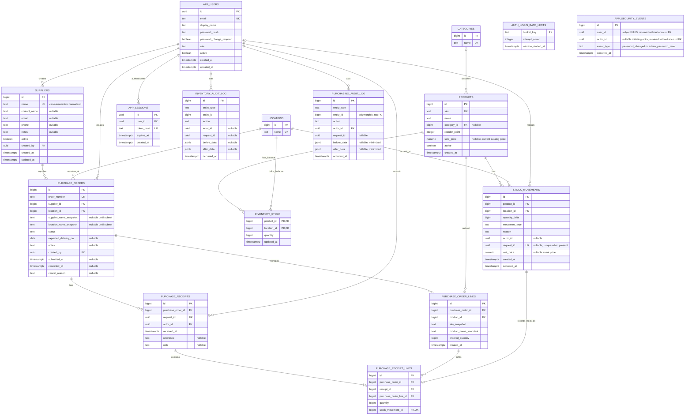
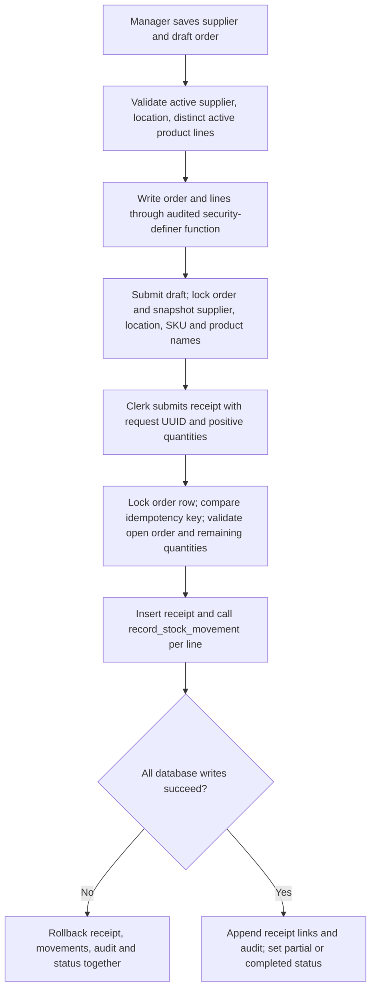
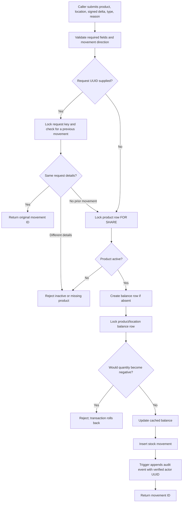

# Retail Inventory Database Design

**Portfolio overview · PostgreSQL 17 · TypeScript/Next.js application**  
**Maintained project document · Last updated 2026-10-14**

## Purpose

This document explains the relational database design for a retail inventory portfolio project. It is written for reviewers who want to understand how catalog data, stock by location, supplier purchasing, movement history, audit events, and sign-in fit together. The SQL source of truth is in migrations [`001`](../db/001_initial.sql) through [`021`](../db/021_jsonb_object_length_compatibility.sql); notable files include product and inventory controls, demo seed, auth/session schema, authenticated audit functions, supplier and purchase-order records, transactional receiving, login-throttle storage, session revocation rules, and the purchasing JSONB compatibility helper. Operational commands are in [`DATABASE.md`](DATABASE.md).

The current web application includes catalog, stock, movement activity, supplier directory, purchase orders, authentication, role-based permissions, database-backed login throttling, and automatic session revocation after role/deactivation/password changes. Purchase orders track quantities only: supplier costs, invoices, payments, tax, and accounting entries are outside scope. Signed-in users can change a password after re-entering the current password. Administrators can set a temporary password for an active user; the user must replace it before entering protected application pages. `/activity` displays verified actors for new movements; pre-authentication demo rows have a NULL actor. Migrations 008-010 add application users, sessions, authenticated product auditing, and actor foreign keys; migration 011 adds hashed rate-limit buckets; migration 014 adds role/deactivation session revocation; migration 016 adds password-change events; migration 017 adds forced password change and administrator actor attribution; migration 018 classifies every forced credential as an administrator reset, including seed tooling without an actor session. Migrations 019-020 add supplier and purchasing tables, immutable receipt/audit history, controlled lifecycle functions, and least-privilege grants; migration 021 supplies a restricted JSONB object-length helper used by the purchasing line validators. Role enforcement is in trusted app server code and repeated for purchasing writes inside PostgreSQL; the actor UUID is still supplied by the trusted app server over the shared application database role.

## Entity relationship diagram

In this diagram, `PK` means primary key, `FK` means foreign key, and `UK` means a unique key or unique index. The product-to-category relationship is optional on the product side: a product can have no category or one category; a category can classify zero or more products.

`INVENTORY_AUDIT_LOG` is intentionally not drawn with a normal entity foreign-key connector for the entity itself: it stores a polymorphic `(entity_type, entity_id)` reference for product and stock-movement audit events, which PostgreSQL does not enforce as a single foreign key. Actor IDs are real nullable foreign keys to `APP_USERS`; they stay NULL on pre-authentication seed rows and point to the signed-in app user for new writes.

`AUTH_LOGIN_RATE_LIMITS` is intentionally unconnected to the business entities: its key is an HMAC digest of a normalized email/client pair or client address. It retains no raw email/IP and uses a time window; expired buckets are pruned in bounded batches during later sign-in attempts.

`APP_SECURITY_EVENTS` keeps the subject UUID, nullable initiating actor UUID, event type, and timestamp for password changes and administrator resets. It deliberately has no account foreign keys, so deleting either account does not erase security history; it stores no email, password, or password hash. A restricted database trigger writes the event and revokes all sessions as part of the password update. For administrator resets, the trusted application route supplies the actor from the verified server session; this attribution is application-enforced rather than independently authenticated by PostgreSQL. The application runtime role cannot read or write this table directly.

Purchasing is normalized across supplier, order header, order lines, receipt header, and receipt lines. Ordered and received quantities are integers; receipt progress is derived from immutable receipt-line facts instead of maintaining a second writable received counter. A composite foreign key ensures each received line belongs to the same order as its receipt. Each receipt line links to exactly one stock movement, so the movement ledger remains the source for location balances. Submitted headers and product labels are snapshotted to preserve what staff saw at submission; draft order lines can be rewritten only through the audited save function. Supplier deactivation is soft and does not break history. The purchasing audit log uses minimized before/after JSON and a polymorphic entity reference; its `entity_id` is not a foreign key. Snapshots intentionally omit supplier contact details and free-form notes so they are not duplicated into permanent audit history. Receipt rows, receipt lines, and purchasing audit rows reject ordinary mutation and truncation.

## Tables and keys

| Table | Purpose and important fields | Key and integrity rules |
| --- | --- | --- |
| `categories` | Reusable product classification with a name. | Identity primary key; trimmed, case-insensitive unique name. |
| `products` | Retail catalog record: SKU, name, optional category, reorder point, current sale price, active flag, creation time. | Identity primary key; nonblank SKU and name; SKU is case-insensitively unique after trimming; category is an optional foreign key. Price is nullable and nonnegative; reorder point is nonnegative. |
| `locations` | Store, stockroom, or other inventory location. | Identity primary key; nonblank unique name. |
| `inventory_stock` | Current cached quantity for one product at one location. | Composite primary key `(product_id, location_id)`; both columns are foreign keys; quantity cannot be negative. |
| `stock_movements` | Append-only record of a quantity change, including reason, type, optional request/actor IDs, and optional event unit price. | Identity primary key; required product and location foreign keys; nonzero signed quantity; request ID is unique when supplied. |
| `inventory_audit_log` | Before/after product records and stock-movement audit events. | Identity primary key; audit rows reject ordinary update/delete/truncate operations. Its polymorphic entity reference is not a foreign key. |
| `save_product` | Controlled database function used by the catalog create/edit form. | Security-definer function with fixed search path; validates product fields; granted to `inventory_app`, not `PUBLIC`. Product triggers append audit changes. |
| `stock_balances` | Read view exposing product, location, and quantity from `inventory_stock`. | A view, not a stored table or independent source of truth. |
| `schema_migrations` | Migration version, SHA-256 checksum, and application time. | Migration version is the primary key; the runner rejects edits to a migration already recorded as applied. |
| `app_users` | Application identity, normalized unique email, scrypt password hash, role, active state, and forced-password-change flag. | UUID primary key; email case-insensitively unique; role constrained to the defined role set. Temporary credentials require a replacement before access to protected pages or actions. |
| `app_sessions` | Hashed opaque login token with user and expiry. | UUID primary key; user foreign key; token hash unique; raw cookie token is never persisted. |
| `auth_login_rate_limits` | Short-lived attempt counters keyed by HMAC digests for email/client and client scopes. | Digest bucket key is the primary key; no raw identity or IP address is stored; runtime can only call the narrow security-definer functions. |
| `app_security_events` | Append-only record of password changes and administrator resets, with subject and initiating actor UUIDs. | Identity primary key; event type constraint; deliberately has no account foreign keys so history survives account removal; runtime has no direct table access. |
| `suppliers` | Reusable retail supplier contact details and soft-active status. | Identity primary key; case-insensitive unique normalized name; creator foreign key; constrained optional contact fields; inactive suppliers remain readable through existing orders. |
| `purchase_orders` | Supplier and destination header, status, optional expected date/notes, creator, and submission/cancellation timestamps. | Identity primary key; unique generated PO number; supplier/location/creator foreign keys; lifecycle and submitted-snapshot constraints; no costs or currency. |
| `purchase_order_lines` | Product and positive ordered whole-unit quantity, plus SKU/name snapshots. | Identity primary key; order/product foreign keys; each product once per order; composite `(purchase_order_id,id)` key supports same-order receipt-line references; line writes guarded to drafts. |
| `purchase_receipts` | One receipt request against an order, with actor, timestamp, and optional delivery reference/note. | Identity primary key; order/actor foreign keys; globally unique request UUID for exact retries; append-only after insert. |
| `purchase_receipt_lines` | Received positive quantity for one order line, with its stock movement identity. | Identity primary key; composite foreign keys bind receipt and line to the same order; one line per order line per receipt; stock movement unique foreign key; append-only. |
| `purchasing_audit_log` | Minimized append-only supplier, order, and receipt audit events. | Identity primary key; actor foreign key; polymorphic entity ID is not a foreign key; before/after JSON excludes contact values and freeform notes. |

`stock_movements.created_at` is retained from the initial schema; `occurred_at` was added for the effective event time. New movements set both when written through the database function. Existing rows receive a default `occurred_at` during migration 002.

## Supplier and purchase-order transaction flow

Migration 019 creates the normalized purchasing records, constraints, indexes, and append-only guards. Migration 020 adds controlled supplier/order/receipt routines and grants the runtime role read access plus function execution only. The function owner receives narrow reads on user role/status and locations, precise table/sequence grants, and calls the existing stock-movement function so balance updates, movement attribution, and receipt records commit together. Receipt retries with the same request UUID return the original receipt only when actor, order, note/reference, and sorted line payload all match. Reusing that UUID for different details is rejected. Concurrent receipts serialize by locking the parent order before evaluating remaining quantities. Cancelling a draft, submitted, or partially received order records a reason and preserves all receipt facts; only the remainder is closed. Inactive products cannot be received.

Purchasing application capabilities are `suppliers:read`, `suppliers:write`, `suppliers:manage`, `purchase_orders:read`, `purchase_orders:write`, and `purchase_orders:receive`. All roles can read; manager/admin can write suppliers and orders; only admin can deactivate suppliers; clerk/manager/admin can receive order lines. Each server page/action checks permission, and database purchasing functions independently verify the supplied actor's current active role. This does not make the human user a distinct PostgreSQL principal: the app still supplies the actor UUID over `inventory_runtime`.

## Normalization and the balance projection

The catalog is split into products, categories, and locations so repeated descriptive data is stored once and referenced by keys. Stock movement facts refer to product and location identities rather than repeating their names. This reduces update anomalies when a product or location name changes and provides referential integrity for movement records.

The movement table is the historical record of quantity changes. `inventory_stock` is a deliberate cached projection keyed by product and location, rather than another independently edited business fact. The `record_stock_movement` function updates this projection and appends the movement in the same transaction. The view `stock_balances` gives readers a stable balance-shaped query. Keeping the projection makes current-balance reads straightforward while preserving a movement trail for explaining how stock changed.

`products.sale_price` represents the current catalog price; `stock_movements.unit_price` can preserve a price associated with a particular movement. That distinction avoids rewriting old event details when a catalog price changes. The schema does not yet define a full valuation policy.

## Stock transaction and audit flow

The function validates a nonzero delta, supported movement type, movement direction for receiving/returns/sales, and a nonblank reason. Migration 005 locks the product row `FOR SHARE` and requires it to be active, preventing a concurrent deactivation from racing with a new stock movement. The balance row lock serializes writes for the same product/location. An optional request UUID provides idempotency for matching retries and rejects reuse for different movement details. Product insert/update/delete triggers record before/after product data; a stock-movement trigger records new movement events. Application actions pass the user ID resolved from the verified server session; legacy seed rows and database-only checks can retain a NULL actor.

## Security and audit boundaries

Migration 002 creates `inventory_app` as a `NOLOGIN` role with limited reads and stock-function execution; migration 003 adds product-function execution. Security-definer routines are owned by the separate `inventory_function_owner` `NOLOGIN` role with only the table and sequence privileges they need. Their fixed `search_path` is `pg_catalog, public, pg_temp`, with the temporary schema last. The product form calls `save_product` with parameterized values using `APP_DATABASE_URL`; `inventory_runtime` is provisioned as a separate login that inherits the group role. The route and write action are disabled outside local development. This is a useful local boundary, not a claim of production-grade security.

Audit actor IDs are nullable. Application actions resolve the actor from a database-validated server session and pass it to the controlled database function; PostgreSQL does not independently authenticate that application identity. Migration 002 records events after its triggers are installed and does not backfill earlier product or movement events. Movement and audit rows reject ordinary updates/deletes, with truncate guards for those history tables; database owners and administrators can change or bypass these controls. Product changes remain allowed and generate audit events when their triggers execute. Production deployment has not been implemented or reviewed.

This is an inventory history, not a complete financial accounting ledger. It does not implement double-entry bookkeeping, inventory valuation, reconciliation, close periods, payments, taxes, or compliance controls. See [`SECURITY.md`](SECURITY.md) for additional limits and deployment work.

## Migration and reproducibility

Schema changes are saved as ordered SQL files in `db/`. `npm run db:migrate` serializes migration runs with a PostgreSQL advisory lock and records each migration checksum in `schema_migrations`. A changed, already-applied migration is rejected; new schema work belongs in a new numbered file. `npm run db:check` verifies that the configured PostgreSQL connection works.

To apply or upgrade the local development database from PowerShell, run `scripts/setup-database.ps1`. This project documents clean reset, backup, and restore procedures in [`DATABASE.md`](DATABASE.md). The reset deletes the local development volume and must only be used when that data is disposable.

## Current implementation status

- Migration 001 defines the initial products, locations, movements, and aggregate balance view.
- Migration 002 defines categories, normalized SKU uniqueness, cached balances, typed movement events, audit triggers, the controlled stock function, and group-role grants.
- Migration 003 defines the controlled catalog-write function and restricted function owner. The owner reported migrations 003 and `inventory_runtime` provisioning succeeded.
- Migration 004 inserts `Demo Store` only if no location exists.
- Migration 005 updates the stock function to require an active product while holding a `FOR SHARE` lock.
- Migration 006 ensures both demo locations exist, even when migration 004 skipped `Demo Store` because a location was already configured.
- Migration 007 seeds three fictional products and eight audited movement entries through the controlled product and stock functions, preserving existing matching rows.
- Migration 016 adds append-only password-change security events and revokes all user sessions when a password hash changes.
- Migration 017 adds the `password_change_required` account flag, administrator-reset events with the verified application actor UUID, and an index for actor/time queries. Reset events preserve actor and subject UUIDs without foreign keys so account removal does not erase the audit history. Migration 018 classifies any password-hash update that leaves `password_change_required` enabled as an administrator-reset event, including local seed tooling without a signed-in actor.
- Login verifies the password and creates its session while holding an account-row lock. An administrator reset locks actor and target accounts in stable order, updates the password hash and forced-change flag, and relies on the trigger to write the audit event and revoke sessions in the same transaction.
- A newly created or admin-reset account must replace its temporary password through `/account/security` before the authorization helpers allow protected pages or actions. Email recovery is not implemented.
- `/stock` implements selected-location active-product balances, reorder attention, stock receipt, sellable returns, manual sale deductions, and manager/administrator count adjustments. `/activity` implements location/type/text filters and a newest-first list capped at 200 movements.
- Migrations through 021, database checks, and rollback-only stock, purchasing, and authentication verifiers passed locally. The signed-in admin walkthrough completed PO-00000007 with two receipts and confirmed linked movement and audit history at Demo Outlet. `npm audit --omit=dev` found zero production dependency vulnerabilities. GitHub Actions passed the production build and workflow for [main commit aa5fd6f](https://github.com/sysinfo7/Inventory_System/actions/runs/38650403985), [documentation commit 4cc752b](https://github.com/sysinfo7/Inventory_System/actions/runs/38652134661), and [release tag v1.6.0](https://github.com/sysinfo7/Inventory_System/actions/runs/38652134590). Purchasing screenshots remain future work; the local Windows production build hit worker and `.next` output permission errors. The expanded rollback-only stock and auth checks passed locally for returns, adjustments, login throttling, clerk/manager boundaries, audit writes, and session revocation. The local backup was restored and verified separately. The activity page supports actor and inclusive UTC date filters. Administrator-reset CI coverage passed on main commit `eba62e7` in [run 38640141612](https://github.com/sysinfo7/Inventory_System/actions/runs/38640141612); see [setup status](../SETUP_STATUS.md) for prior release evidence and remaining checks. A second off-checkout backup copy and production deployment review remain future work.
- No sample production or customer information is included. Use fictional data in demos.

Update this document whenever a migration changes a table, column, key, relationship, constraint, index, database function, trigger, role grant, or implementation status. Keep the diagram and relationship descriptions aligned with the SQL files, and clearly separate implemented behavior from planned application features. It is also linked from the README and database operations guide.
