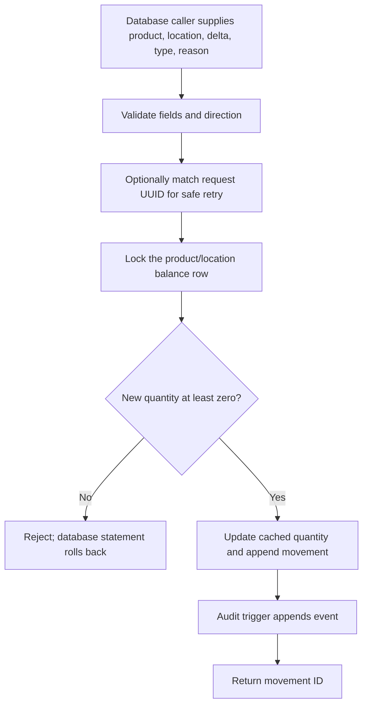

# User manual

## What you can use today

The app includes a local product catalog. Search by name or SKU, filter active/inactive products, add products, edit details, and deactivate items by changing their status. Product stock is not changed on this form. Stock receiving and issue, returns, balance insights, low-stock alerts, and authentication are still planned.

The owner reported migration 002 applied successfully. Migration 003 adds the catalog's restricted database save function and must be applied before catalog changes can be saved. The limited local application login must also be provisioned. A successful migration by itself does not confirm the catalog connection is ready.

## Start the local project

From the repository folder in PowerShell, create `.env` from `.env.example`, use the same local database password for `DB_PASSWORD` and `DATABASE_URL`, and set a different URL-safe random password of at least 32 characters in `APP_DATABASE_URL`. Install the locked dependencies:

```powershell
Copy-Item .env.example .env
# Edit .env locally; the app password must be distinct from the migration password.
npm ci
```

To generate and save a separate application password without displaying it, run the local helper from the project folder:

```powershell
.\scripts\configure-app-url.ps1
```

It writes only to the git-ignored `.env` and refuses to replace an existing app URL. Do not share or commit `.env`.

Apply any pending migrations, provision the limited app login, and start the local-only web server:

```powershell
.\scripts\setup-database.ps1
npm run db:provision-app
npm run dev
```

The owner reported migration 002 succeeded. Migration 003 and the application login still need to be applied/verified for this catalog version. The app and PostgreSQL bind to loopback for local use. Open [http://127.0.0.1:3000](http://127.0.0.1:3000). See [DATABASE.md](DATABASE.md) for migration, role, backup, restore, and destructive reset details.

Stop the web server with `Ctrl+C`. To stop PostgreSQL while keeping local data, run:

```powershell
docker compose stop
```

## Product catalog walkthrough

1. Open the home page and select **Explore product catalog**, or choose **Products** in the navigation.
2. Search by product name or SKU and choose Active products, Inactive products, or All statuses.
3. Select **Add product** and enter a unique SKU, product name, optional category and sale price, reorder point, and status.
4. To edit or deactivate, select **Edit** on a product. Set its status to Inactive to keep it out of the active list while preserving the product and its history.
5. Save the form. Duplicate SKUs, invalid prices or reorder points, and unavailable categories are rejected with a useful message.

Sale prices are decimal amounts; no currency has been configured. Editing catalog details never creates or changes stock. Stock changes will use the movement history in a later feature.

## Local demo and security limits

Authentication and authorization are not implemented. The catalog page and writes are restricted to local development, and the development server binds to `127.0.0.1`. Use fictional data and do not expose the server to untrusted users. The web app uses the separate `APP_DATABASE_URL` login; migration commands use the more privileged `DATABASE_URL`. Product audit entries have a generated request ID but no verified actor identity. See [SECURITY.md](SECURITY.md).

## Planned stock operation (no UI yet)

The database function `record_stock_movement` is the intended controlled stock-write path. It validates movement direction and reason, supports idempotent request UUIDs, locks the relevant cached balance row, rejects a negative result, then updates `inventory_stock` and appends a movement record. A trigger appends an audit event in the same database statement transaction.



This diagram describes the database function, not an end-user workflow. The app does not call it yet. Stock actor UUID attribution is optional and caller-controlled until authenticated identity is implemented; it does not prove who performed an operation.

## Screenshots still needed

No real screenshots have been captured yet because the available browser preview could not reach the local app. These are the portfolio captures to add after opening the running local project in an available browser:

| File | Required capture |
| --- | --- |
| `docs/screenshots/home-desktop.png` | Home page at desktop width. |
| `docs/screenshots/home-mobile.png` | Home page at a narrow mobile viewport. |
| `docs/screenshots/catalog.png` | Product list with fictional records. |
| `docs/screenshots/product-form.png` | Add/edit form and a real validation result. |
| `docs/screenshots/stock-movement.png` | Receive/issue UI and a verified result after that workflow is implemented. |
| `docs/screenshots/stock-insights.png` | Balance and low-stock UI after those screens are implemented. |

Never show credentials in screenshots. Do not substitute generated images or mockups for captures of the running application.
