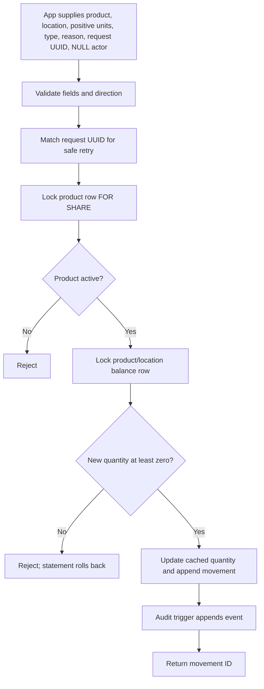

# User manual

## What you can use today

The app includes a local product catalog, stock page, and activity page. The catalog supports search, active/inactive filters, add/edit, and deactivate. `/stock` shows current balances for active products at the selected location, flags quantities at or below each product's reorder point, and provides receive and manual sale-deduction forms. `/activity` filters and lists recent signed movement rows. Returns, adjustments, authentication, and a separate dashboard remain planned.

Migrations through 007 are applied to the current local database. The rollback-only stock workflow verification passed. The current demo contains two locations, three fictional products, and eight audited movement rows; the sample data is recreated after a clean reset.

## Start the local project

From the repository folder in PowerShell, create `.env` from `.env.example`, use the same local database password for `DB_PASSWORD` and `DATABASE_URL`, and set a different URL-safe random password of at least 32 characters in `APP_DATABASE_URL`. Install the locked dependencies:

```powershell
Copy-Item .env.example .env
# Edit .env locally; the app password must be distinct from the migration password.
npm ci
```

To generate and save a separate application password without displaying it, run the local helper from the project folder:

```powershell
.\scripts\configure-app-url.ps1
```

It writes only to the git-ignored `.env` and refuses to replace an existing app URL. Do not share or commit `.env`.

Apply pending migrations, provision the limited app login if it is not already provisioned, run the rollback-only stock verification script after migrations, and start the local-only web server:

```powershell
.\scripts\setup-database.ps1
npm run db:provision-app
npm run db:verify-stock
npm run dev
```

`db:verify-stock` checks receipt, sale, idempotent retry, conflicting request token, oversell rejection, inactive product rejection, resulting balance, and blank-actor audit rows in a single transaction that is rolled back. It passed against the current local database. The app and PostgreSQL bind to loopback for local use. Open [http://127.0.0.1:3000](http://127.0.0.1:3000). See [DATABASE.md](DATABASE.md) for migration, role, backup, restore, and destructive reset details.

Stop the web server with `Ctrl+C`. To stop PostgreSQL while keeping local data, run:

```powershell
docker compose stop
```

## Product catalog walkthrough

1. Open the home page and select **Explore product catalog**, or choose **Products** in the navigation.
2. Search by product name or SKU and choose Active products, Inactive products, or All statuses.
3. Select **Add product** and enter a unique SKU, product name, optional category and sale price, reorder point, and status.
4. To edit or deactivate, select **Edit** on a product. Set its status to Inactive to keep it out of the active list while preserving the product and its history.
5. Save the form. Duplicate SKUs, invalid prices or reorder points, and unavailable categories are rejected with a useful message.

Sale prices are decimal amounts; no currency has been configured. Editing catalog details never creates or changes stock. Stock changes are recorded as movement history through the separate stock workflow.

## Local demo and security limits

Authentication and authorization are not implemented. Catalog, stock, and activity pages/actions are restricted to local development, and the development server binds to `127.0.0.1`. Use fictional data and do not expose the server to untrusted users. The web app uses the separate `APP_DATABASE_URL` login; migration commands use the more privileged `DATABASE_URL`. Product audit entries have a generated request ID, while stock actions pass a NULL actor ID; neither identifies a verified human user. See [SECURITY.md](SECURITY.md).

## Stock on hand and recording a movement

Open `/stock`. Choose a location and select **Show stock** to view active products, current on-hand counts, reorder points, and reorder attention for that location. Reorder attention means the location's current on-hand quantity is at or below the product's reorder point; it does not include reservations or open orders.

The local demo has two locations. **Demo Outlet** has 10 coffee units and 13 trail-mix units. **Demo Store** has 7 coffee units and 8 water bottles. All other sample product/location balances start at zero. The three sample items are Northstar Coffee Beans, Crisp Orchard Trail Mix, and Summit Steel Water Bottle; their SKUs start with `DEMO-`.

To receive stock or record a manual sale deduction, choose the location and active product, enter a positive whole number of units, and provide a reason. Review the movement preview before submitting. The receiving action adds units; the sale action stores a negative quantity delta. If the sale would make stock negative, the database rejects it and the page reports the latest available quantity. Inactive products cannot receive new movements after migration 005 is applied. Each submission uses a request UUID so an identical retry does not create a duplicate movement.

These are inventory quantity records only. They do not process payments, record a POS sale, or create accounting entries. Authentication is absent and the action writes a NULL actor ID.

## Movement activity

Open `/activity` to see the newest stock movements first. Filter by location, movement type, or text matching product name, SKU, or reason. Results show UTC time, product/SKU, location, movement type, signed units, and reason, up to 200 matching rows. The activity page does not display a verified human actor because the current stock action passes NULL and no authentication exists.

## Database stock operation

The app calls the controlled function `record_stock_movement`. It validates movement direction and reason, handles idempotent request UUIDs, checks that the product is active under a `FOR SHARE` lock, then locks the cached balance row. It rejects a negative result and updates `inventory_stock` while appending the movement record in one database statement transaction. A trigger appends an audit event.



The database workflow and rollback-only transaction check have been exercised. The sample data includes eight movements across both locations (four receiving entries and four sale deductions); filtering activity to Demo Store returns four rows. No concurrent deductions were tested at runtime. The blank actor cannot identify who performed the action.

## Screenshots still needed

Repository screenshots have not yet been saved. The local app is now reachable with fictional sample data and migrations through 007 applied; capture these views from the running app:

| File | Required capture |
| --- | --- |
| `docs/screenshots/home-desktop.png` | Home page at desktop width. |
| `docs/screenshots/home-mobile.png` | Home page at a narrow mobile viewport. |
| `docs/screenshots/catalog.png` | Product list with fictional records. |
| `docs/screenshots/product-form.png` | Add/edit form and a real validation result. |
| `docs/screenshots/stock-on-hand.png` | Selected location, active product balances, and reorder attention. |
| `docs/screenshots/stock-movement.png` | Receive form, manual sale deduction, and a real success or validation result. |
| `docs/screenshots/activity.png` | Filters and signed movement rows, with fictional data. |

Never show credentials in screenshots. Do not substitute generated images or mockups for captures of the running application.
