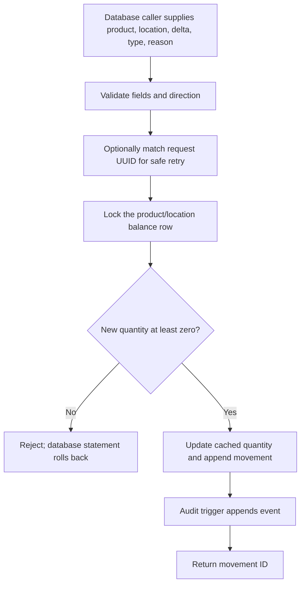

# User manual

## What you can use today

The running web app currently presents a project-status landing page. It introduces the project and labels three areas as planned: product catalog, stock movements, and inventory insights. There are no login, catalog, receiving, sale, return, adjustment, search, balance, or alert screens yet.

Migration 002 defines database structures and a PostgreSQL function for future inventory writes, but it remains unapplied to the owner's local database and is not connected to the web app. A database migration succeeding does not mean the corresponding UI workflow is available.

## Start the local project

From the repository folder in PowerShell, create `.env` from `.env.example`, replace both password placeholders with the same long random local-development value, and install the locked dependencies:

```powershell
Copy-Item .env.example .env
# Edit .env locally; do not share or commit it.
npm ci
```

For a new database or an existing local database that needs the latest schema, run the setup/upgrade wrapper. It starts PostgreSQL, applies unapplied migrations, and checks the connection:

```powershell
.\scripts\setup-database.ps1
npm run dev
```

Open [http://localhost:3000](http://localhost:3000). PostgreSQL is published locally at `localhost:5433`. The owner must run the setup wrapper to apply migration 002; it was not applied from this agent session. See [DATABASE.md](DATABASE.md) for backup, restore, migration, and destructive reset instructions.

Stop the web server with `Ctrl+C`. To stop PostgreSQL while keeping local data, run:

```powershell
docker compose stop
```

## Current page walkthrough

1. Open `http://localhost:3000`.
2. Read the project-foundation heading and description.
3. Review the three cards. Each explicitly labels its feature as planned.

There are no data-entry actions on the current page. For a portfolio demo, describe the implemented database controls separately from the unimplemented catalog and stock workflows.

## Database stock operation (no UI yet)

The database function `record_stock_movement` is the intended controlled write path. It validates movement direction and reason, supports idempotent request UUIDs, locks the relevant cached balance row, rejects a negative result, then updates `inventory_stock` and appends a movement record. A trigger appends an audit event. The operation is atomic at the database statement level.



This diagram describes database behavior, not an end-user screen. The current application does not invoke this function. Actor UUID attribution is optional and caller-controlled because authentication is not implemented; it is not proof of who performed an operation. See [SECURITY.md](SECURITY.md).

## Screenshots still needed

No browser or running app was available during this documentation update, so no screenshot was captured. These are the exact outstanding portfolio captures:

| File | Required capture |
| --- | --- |
| `docs/screenshots/home-desktop.png` | Real current landing page at desktop width |
| `docs/screenshots/home-mobile.png` | Real current landing page at narrow mobile width |
| `docs/screenshots/catalog.png` | Catalog only after its UI is implemented |
| `docs/screenshots/stock-movement.png` | Receive/issue UI and verified result only after implementation |
| `docs/screenshots/stock-insights.png` | Balance and low-stock UI only after implementation |

Use fictional data and ensure no credentials are visible. Do not substitute mockups or generated images for screenshots of the running application.
