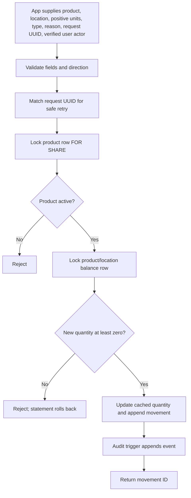

# User manual

## What you can use today

The app includes a local product catalog, multi-location stock page, activity history, sign-in, and role-based permissions. The catalog supports search, active/inactive filters, add/edit, and deactivate. `/stock` shows current balances for active products at the selected location, flags quantities at or below each product's reorder point, and provides receiving, customer-return, sale-deduction, and manager/admin count-adjustment forms. `/activity` filters recent signed movements and shows the actor for newly authenticated changes. Administrators can create and deactivate accounts with Administrator, Manager, Clerk, or Read-only roles. Changing a role or deactivating an account revokes all of that user's sign-in sessions. The overview page links to the main workflows.

Migrations through 014 are applied to the current local database. The rollback-only stock workflow verification passed, and auth verification includes login throttling and session revocation after role changes or deactivation. The current demo contains two locations, three fictional products, and eight sample movement rows; the sample data is recreated after a clean reset. The initial sample actor is blank; new app-recorded changes identify the signed-in user.

## Start the local project

From the repository folder in PowerShell, create `.env` from `.env.example`, use the same local database password for `DB_PASSWORD` and `DATABASE_URL`, and set a different URL-safe random password of at least 32 characters in `APP_DATABASE_URL`. Install the locked dependencies:

```powershell
Copy-Item .env.example .env
# Edit .env locally; the app password must be distinct from the migration password.
npm ci
```

To generate and save a separate application password without displaying it, run the local helper from the project folder:

```powershell
.\scripts\configure-app-url.ps1
```

It writes only to the git-ignored `.env` and refuses to replace an existing app URL. Do not share or commit `.env`.

Apply pending migrations, provision the limited app login if it is not already provisioned, run the rollback-only stock verification script, and start the local web server:

```powershell
.\scripts\setup-database.ps1
npm run db:provision-app
npm run db:verify-stock
npm run auth:bootstrap
npm run dev
```

`db:verify-stock` checks receipt, sale, idempotent retry, conflicting request token, oversell rejection, inactive product rejection, resulting balance, and an audit row in a transaction that is rolled back. Run `npm run auth:bootstrap` once to create a personal admin account; it asks for a private 14-character-or-longer password and doesn't echo it. The app and PostgreSQL bind to loopback for local use. Open [http://127.0.0.1:3000](http://127.0.0.1:3000). Login throttling allows up to eight attempts per email/client pair and 100 attempts per local client in 15 minutes. If the limit is reached, wait for the retry period before signing in again. In a second PowerShell window from the project folder, `npm run auth:verify` creates a temporary account and checks sign-in, permissions, logout, login throttling, response headers, and actor audit attribution; it removes the account with the local database administrator connection. After upgrading from an earlier verifier that could leave test rows, run `npm run auth:cleanup-checks` once. See [DATABASE.md](DATABASE.md) for migration, role, backup, restore, and destructive reset details.

Stop the web server with `Ctrl+C`. To stop PostgreSQL while keeping local data, run:

```powershell
docker compose stop
```

## Product catalog walkthrough

1. Open the home page and select **Open product catalog**, or choose **Products** in the navigation.
2. Search by product name or SKU and choose Active products, Inactive products, or All statuses.
3. Select **Add product** and enter a unique SKU, product name, optional category and sale price, reorder point, and status.
4. To edit or deactivate, select **Edit** on a product. Set its status to Inactive to keep it out of the active list while preserving the product and its history.
5. Save the form. Duplicate SKUs, invalid prices or reorder points, and unavailable categories are rejected with a useful message.

Sale prices are decimal amounts; no currency has been configured. Editing catalog details never creates or changes stock. Stock changes are recorded as movement history through the separate stock workflow.

## Sign in and test role permissions

Apply current migrations and confirm the runtime DB login is provisioned. Create your personal administrator account locally; the command prompts for email, display name, and a unique password and never saves the password in the repository:

```powershell
npm run auth:bootstrap
```

Start `npm run dev`, open [http://127.0.0.1:3000/login](http://127.0.0.1:3000/login), and sign in. The **Permissions** page displays the role matrix. Test accounts are optional. Create fictional Manager, Clerk, and Read-only accounts:

```powershell
npm run auth:seed-test-users
```

Type `YES` at the prompt. It prints generated passwords once in the local terminal. Save them somewhere private if needed; they are not stored in this manual or Git. Run the command again to rotate these test passwords. Their account names are `manager@inventory-demo.invalid`, `clerk@inventory-demo.invalid`, and `viewer@inventory-demo.invalid`.

Sign out and try each test account. Manager can edit products, record stock, and adjust counted inventory. Clerk can receive stock, record sellable customer returns and manual sale deductions, but cannot edit products or correct counts. Read-only can inspect catalog, stock, and activity, but cannot change records. Try opening `/products/new` while read-only: the server redirects to a permission-required page. Server actions also check permission when submitted, so hidden buttons are not the security boundary.

Sessions last eight hours and use HttpOnly/SameSite cookies; signing out revokes the server-side session. Passwords use salted scrypt hashes. Test accounts require explicit opt-in and are not seeded automatically. Rate limiting and account recovery are future hardening work before public deployment. See [SECURITY.md](SECURITY.md).

## Stock on hand and recording a movement

Open `/stock`. Choose a location and select **Show stock** to view active products, current on-hand counts, reorder points, and reorder attention for that location. Reorder attention means the location's current on-hand quantity is at or below the product's reorder point; it does not include reservations or open orders.

The local demo has two locations. **Demo Outlet** has 10 coffee units and 13 trail-mix units. **Demo Store** has 7 coffee units and 8 water bottles. All other sample product/location balances start at zero. The three sample items are Northstar Coffee Beans, Crisp Orchard Trail Mix, and Summit Steel Water Bottle; their SKUs start with `DEMO-`.

To receive stock, record a customer return, or record a manual sale deduction, choose the location and active product, enter a positive whole number of units, and provide a reason. Only return goods that are suitable to put back into sellable inventory; a return adds units, while the sale action stores a negative quantity delta. If a sale would make stock negative, the database rejects it and the page reports the latest available quantity.

Managers and administrators can also use **Inventory adjustment** to correct a physical count. Choose whether the correction increases or decreases on-hand, enter the positive number of units, and explain the count or correction in the reason. The database stores the resulting signed quantity delta. A decrease cannot take stock below zero, zero-unit changes are rejected, and adjustments remain in the append-only movement/audit history. Clerks do not have this permission. Inactive products cannot receive new movements after migration 005 is applied. Each submission uses a request UUID so an identical retry does not create a duplicate movement.

These are inventory quantity records only. They do not process payments, record a POS sale, or create accounting entries. New stock entries carry the signed-in user's ID; old seed movements have no user and display as legacy entries.

## Movement activity

Open `/activity` to see the newest stock movements first. Filter by location, movement type, or text matching product name, SKU, or reason. Results show UTC time, product/SKU, location, movement type, signed units, reason, and the signed-in actor when available, up to 200 matching rows.

## Database stock operation

The app calls the controlled function `record_stock_movement`. It validates movement direction and reason, handles idempotent request UUIDs, checks that the product is active under a `FOR SHARE` lock, then locks the cached balance row. It rejects a negative result and updates `inventory_stock` while appending the movement record in one database statement transaction. A trigger appends an audit event.



The expanded local check passed for returns, both adjustment directions, idempotent retries, zero and oversell rejection, and audit rows; it rolled back its test transaction. The sample seed data starts with eight movements across both locations (four receiving entries and four sale deductions); filtering activity to Demo Store initially returns four rows. Application-created movements include the signed-in actor. The expanded auth verifier also passed for clerk return access and manager-only adjustment visibility. All CI checks passed for release `v1.0.0` on [main](https://github.com/sysinfo7/Inventory_System/actions/runs/38491097632) and [the release tag](https://github.com/sysinfo7/Inventory_System/actions/runs/38491097851).

## Screenshots

These captures show the running local application with fictional demo data. They are evidence of the interface, not proof of a production deployment. No passwords, email addresses, or user-management records are shown.

### Overview and catalog


### Stock and audit history


### Permissions


The current evidence set does not include a narrow mobile viewport or a successful stock-write confirmation screen. The database workflow verifiers cover stock writes and audit events; no permanent stock transaction was added solely for a screenshot. Never include credentials or account email addresses in future captures.
